-----

<div align="center">

<h2>Grocy Modern</h2>
<h3>Grocy mit einem modernen, mobile-first Design</h3>
<em><h4>Persönlicher Fork von <a href="https://github.com/grocy/grocy">grocy</a> — dem Haushalts-ERP von <a href="https://berrnd.de">Bernd Bestel</a></h4></em>
</div>

-----

## Worum geht es hier?

[Grocy](https://grocy.info) ist ein hervorragendes selbst gehostetes Haushalts-ERP — Bestände, Einkaufszettel, Rezepte, Speiseplan, Hausarbeiten. Nur die Oberfläche war mir zu altbacken und am Handy zu unhandlich, vor allem die breiten Tabellen.

Dieser Fork ändert in erster Linie **das Frontend** — es ist dasselbe Grocy, nur mit neuer Oberfläche. Dazu kommen drei funktionale Erweiterungen: ein [Haushaltsbudget](#haushaltsbudget), [Profile](#profile--mehrere-getrennte-haushalte) für mehrere komplett getrennte Haushalte und eine [klügere Barcode-Suche](#barcode-suche). Alle lassen Grocys Datenmodell und REST-API unangetastet.

|  |  |  |
|---|---|---|
| 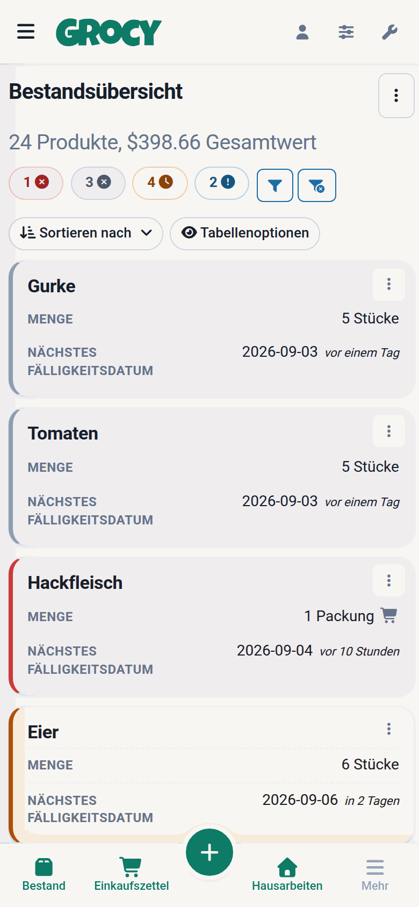 | 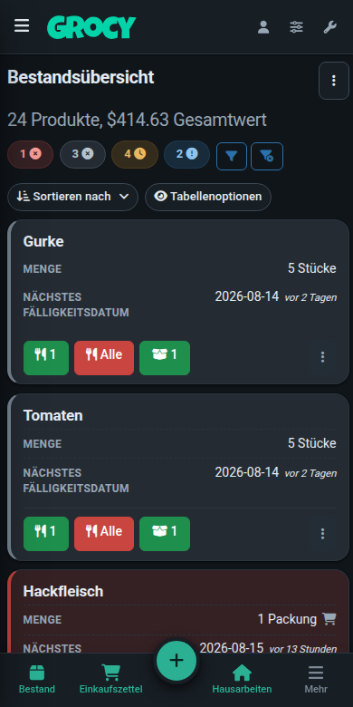 | 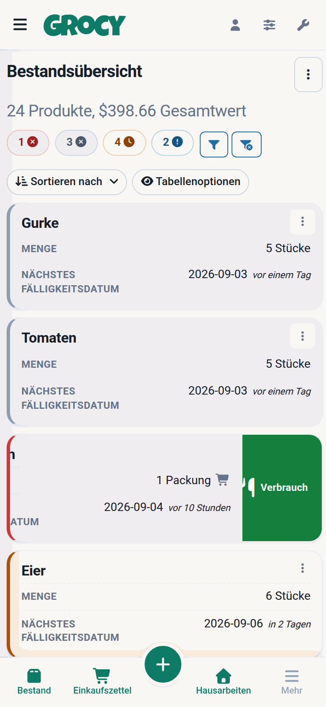 |
| Tabellen werden am Handy zu Karten | Dark Mode über dieselben Design-Tokens | Wischen statt Knöpfe suchen |
| 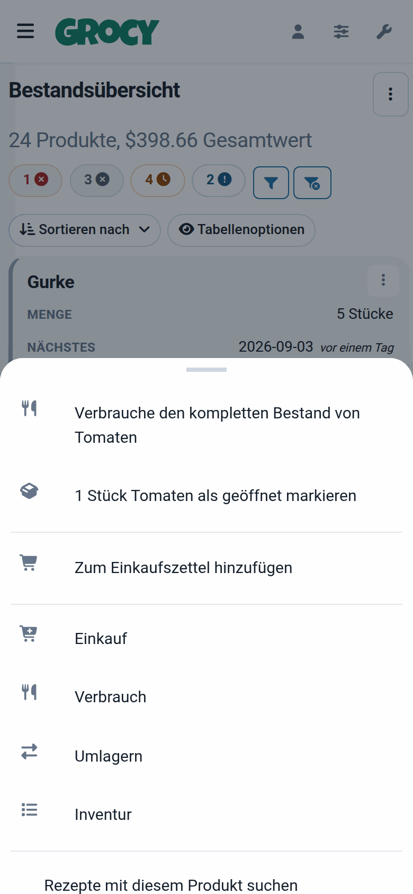 | 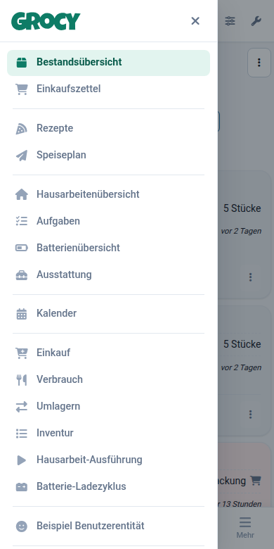 | 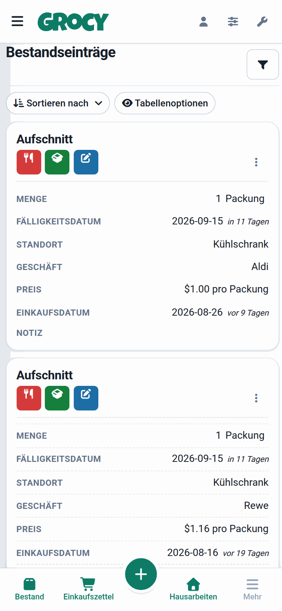 |
| Zeilenmenüs als Bottom-Sheet | Off-Canvas-Navigation statt aufklappendem Menü | Mehr als zwei Aktionen: eigene Zeile |

<p align="center">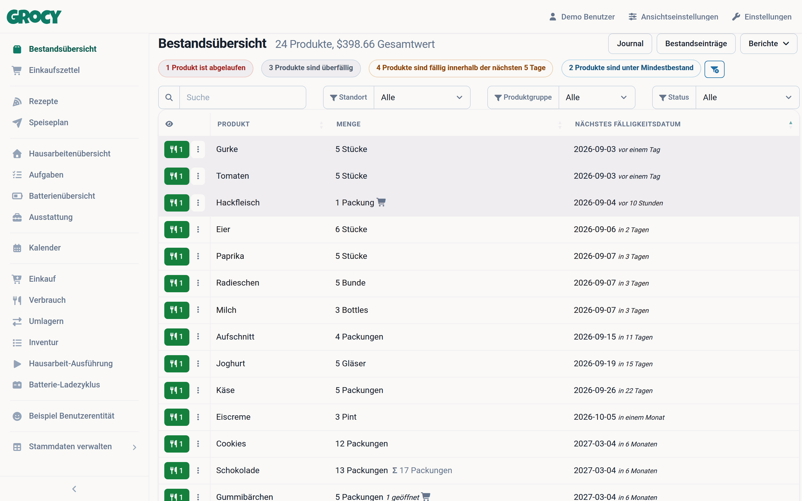</p>
<p align="center"><em>Am Desktop bleibt es eine Tabelle — mit einklappbarer Sidebar</em></p>

## Was ist anders?

**Design-System statt Bootstrap-Standard.** Alle Farben, Radien, Schatten und Typografie sind CSS-Variablen in [`public/css/grocy_theme.css`](public/css/grocy_theme.css). Umfärben heißt: ein paar Variablen überschreiben — am besten in `data/custom_css.html`, dann überlebt es Updates:

```html
<style>
  :root {
    --g-brand: #7c3aed;
    --g-brand-hover: #6d28d9;
    --g-brand-soft: #f0e9fe;
    --g-brand-soft-text: #5b21b6;
  }
</style>
```

**Tabellen werden am Handy zu Karten.** Unter 768 px wird jede DataTable automatisch umgebaut: Produktname als Überschrift, jede Zelle mit ihrem Spaltenkopf beschriftet, Aktionen als Fußzeile, leere Zellen entfallen, Status wird zu einem farbigen Balken. Weil dabei der Tabellenkopf verschwindet, gibt es darüber eine Leiste mit **Sortieren** und **Tabellenoptionen** — beides war am Handy vorher praktisch nicht erreichbar. Das geschieht zentral in [`grocy_datatables.js`](public/js/grocy_datatables.js), keine der 70+ Views musste dafür angefasst werden.

Lange Tabellen werden am Handy außerdem **seitenweise** angezeigt (50 Karten pro Seite, ab 75 Zeilen). Grocy schaltet das Paging generell ab und baut jede Zeile ins DOM — ein Bestandsjournal mit ein paar tausend Einträgen wird als Kartenliste sonst mehrere hunderttausend Pixel lang, braucht Sekunden zum Rendern und ruckelt beim Scrollen. Am Desktop bleibt es beim vollständigen Raster.

**Neue App-Hülle.** Sticky Topbar, ruhigere Sidebar mit Markierung der aktiven Seite, einklappbar auf eine Icon-Leiste. Am Handy ein echter Off-Canvas-Drawer mit Abdunklung, Escape und Wisch-Geste statt eines Menüs, das den Inhalt nach unten schiebt. Dazu eine Bottom-Tab-Leiste mit den wichtigsten Ansichten und einem `+`-Button für Einkauf, Verbrauch, Umlagern und Inventur.

**Wisch-Gesten auf den Karten.** Nach links wischen verbraucht die Schnellverbrauchsmenge, nach rechts setzt das Produkt auf den Einkaufszettel — mit farbigem Feedback während des Wischens. Beides löst die Bedienelemente aus, die in der Zeile ohnehin existieren, also gelten Grocys eigene Logik, Berechtigungen und der Rückgängig-Toast unverändert.

**Dialoge und Zeilenmenüs als Bottom-Sheets.** Am Handy fahren Dialoge von unten ein und lassen sich mit einem Wisch nach unten schließen — auch die Formular-Dialoge, die intern ein iframe sind. Das Zeilenmenü hinter den drei Punkten ist ebenfalls ein Sheet, dessen Höhe sich am tatsächlich sichtbaren Bereich orientiert (`visualViewport`, nicht `vh` — auf iOS sind das zwei verschiedene Dinge).

**Aktionen, die sich nicht in den Weg stellen.** Ein bis zwei Bedienelemente schweben in der Kartenecke und lassen der Überschrift genau so viel Platz, wie sie brauchen; ab drei bekommen sie eine eigene Zeile, statt über dem Text zu liegen.

**Kompakte Toasts.** Eine Zeile statt eines halben Bildschirms; Antippen klappt den vollen Text samt „Rückgängig“ aus.

**Kürzere Formulare.** Das Produktformular zeigte am Handy rund 35 Felder in einer 3.300 px langen Spalte — vier Mengeneinheiten, vier Fälligkeitstage und ein Dutzend Spezialschalter gleichrangig neben Name und Standort. Jetzt steht oben nur, was jedes Produkt braucht: Name, Produktgruppe, Standort, Bestandseinheit, Mindestbestand und Haltbarkeit (mit „Nie überfällig“ statt „-1 bedeutet …“). Der Rest liegt in aufklappbaren Bereichen — *Haltbarkeit*, *Verbrauch & Öffnen*, *Einkauf*, *Beschreibung*, *Weitere Einstellungen* —, die zugeklappt in einer Zeile sagen, was darin gesetzt ist („geöffnet: 3 Tage“, „gehört zu Schokolade“). Offene Bereiche bleiben beim nächsten Mal offen. Beim Einkauf stehen Menge und Einheit nebeneinander, Einzel-/Gesamtpreis ist ein Umschalter neben dem Preis, Geschäft, Standort und Notiz liegen unter einem Bereich, der den Standort schon nennt, und die leere Produktübersicht erscheint erst mit einem Produkt. Ganz oben sitzt am Handy ein großer **„Barcode scannen“**-Knopf statt der kleinen Kamera im Produktfeld — ebenso bei Verbrauch, Umlagern und Inventur.

Dasselbe Prinzip gilt für die übrigen Formulare: Verbrauch (*Standort & Details*), Umlagern (Von/Nach nebeneinander), Inventur (*Geschäft, Standort, Notiz*), Hausarbeit (*Zuweisung*, *Produkt verbrauchen*, *Weitere Einstellungen*) und die kleinen Stammdaten-Formulare (Standort, Mengeneinheit, Produktgruppe, Geschäft, Batterie, Aufgabe), deren Beschreibungs-Editor eingeklappt ist. Alle passen am Handy jetzt auf einen Bildschirm.

Fehler zeigen sich erst, wenn man ein Feld bearbeitet oder speichern will — nicht als rote Wand auf einem leeren Formular; das gilt in allen Formularen. Fehlt beim Speichern etwas in einem zugeklappten Bereich, klappt er auf und ist markiert. Bei Mehrfachauswahlen (wem eine Hausarbeit zugewiesen ist) erscheint der Fehlertext jetzt überhaupt — vorher scheiterte das Speichern dort kommentarlos. Und der Preishinweis („entspricht 2,25 € pro Packung“) hat eine feste Zeile: Er erschien bisher erst beim Verlassen des Preisfelds und schob den OK-Knopf genau in dem Moment weg, in dem man ihn antippte — das Antippen ging dann ins Leere. Alles in [`grocy_forms.js`](public/js/grocy_forms.js); die Views selbst bleiben unverändert, Feld-IDs und -Namen auch, Grocys eigene Skripte laufen wie gehabt.

|  |  |
|---|---|
| 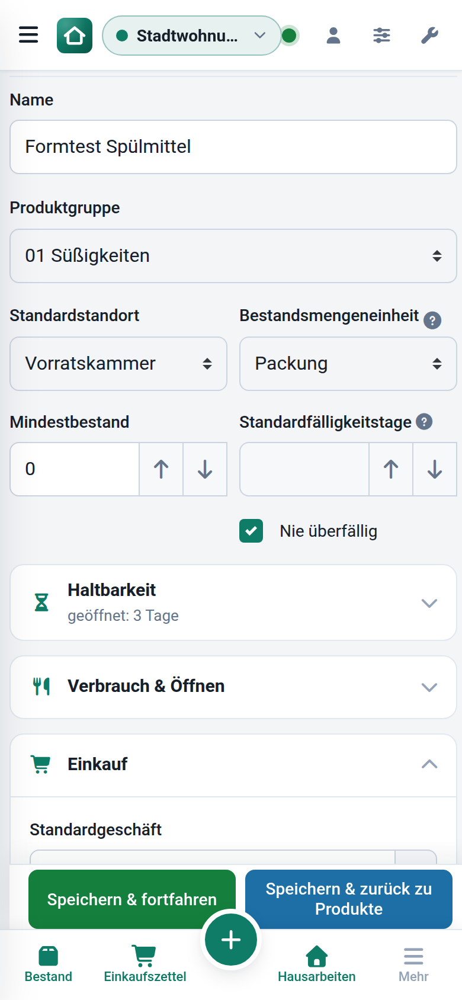 | 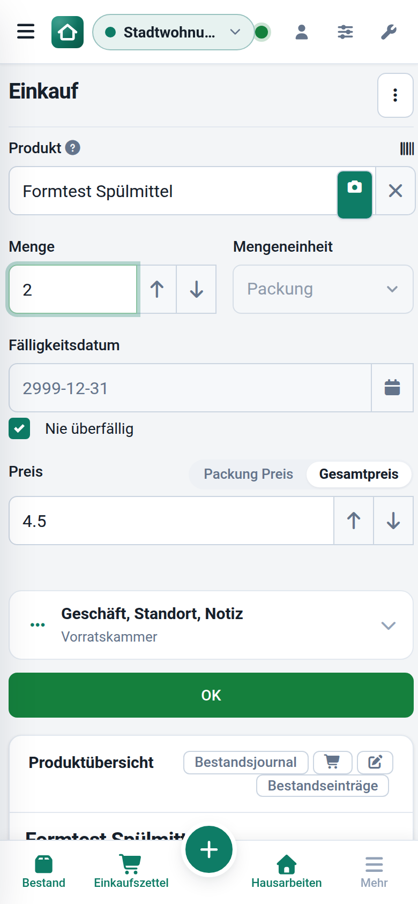 |
| Produkt: das Wichtige oben, der Rest in Bereichen | Einkauf: Scan-Knopf, kompakt, Details unter einem Bereich |

**Datumseingabe, die mitdenkt.** Das MHD-Feld versteht neben `20270515` auch `15052027` und vierstellig `1505` — Tag zuerst, Monat zuerst nur, wenn das kein Datum ergibt. Das Jahr bleibt das aktuelle.

**Eigenes App-Icon und funktionierender Homescreen-Start.** Manifest mit allen Größen inklusive maskable-Variante, dazu ein `apple-touch-icon` — ohne das legte iOS bei „Zum Homescreen“ einen Screenshot der Seite ab.

**Verbindungsampel.** Ein Punkt in der Topbar zeigt, ob Eingaben gerade wirklich beim Server ankommen: grün (alles gut), gelb (langsam, oder eine Anfrage wartet seit mehr als 2,5 s auf Antwort), rot (keine Verbindung, abgemeldet oder Server down). Antippen öffnet die Details samt den letzten Problemen und einem **Verbindungstest**, der auch das typische VPN-Problem erkennt: kleine Anfragen kommen durch, große Antworten nicht — dann ist die MTU des Tunnels zu groß (WireGuard: 1280 eintragen).

Hintergrund: Grocy schickt seine Anfragen ohne Zeitlimit, und die meisten Ansichten schreiben einen Fehler nur in die Browser-Konsole. Bricht die Verbindung kurz weg — typisch, wenn sich das VPN nach dem Entsperren des Handys erst neu verbindet —, hängt eine Anfrage minutenlang oder scheitert lautlos: Das Antippen „tut nichts“, ein Formular bleibt gesperrt, und weil der Browser pro Server nur wenige Verbindungen öffnet, blockieren ein paar hängende Anfragen irgendwann alle weiteren. Deshalb bekommt jetzt jede API-Anfrage ein Zeitlimit von 20 s, danach greift die normale Fehlerbehandlung der Ansicht, und ein Toast sagt, was los ist — bei einem Zeitlimit ausdrücklich, dass unklar ist, ob die Eingabe gespeichert wurde. Das steckt alles in [`grocy_connection.js`](public/js/grocy_connection.js), ohne eine einzige Ansicht anzufassen.

**Dark Mode auf Token-Basis**, dadurch lückenlos über alle Komponenten hinweg.

**Cache-Busting pro Build.** Grocy hängt an jedes Stylesheet die Versionsnummer aus `version.json` — die sich zwischen zwei Fork-Updates nie ändert, weshalb Browser hartnäckig altes CSS behielten. Jetzt trägt der `?v=`-Parameter zusätzlich eine Build-ID (`GROCY_BUILD`, sonst der jüngste Änderungszeitpunkt der Assets).

## Haushaltsbudget

Ein einfaches Budget nach dem Vorbild von [Actual Budget](https://github.com/actualbudget/actual) (dessen „Tracking Budget“): Jede Kategorie bekommt einen Monatsplan, die Übersicht zeigt, was geplant, ausgegeben und noch übrig ist — und wie viel Geld wirklich **frei verfügbar** ist, also Kontostand minus das, was der Plan in diesem Monat noch braucht.

|  |  |  |
|---|---|---|
| 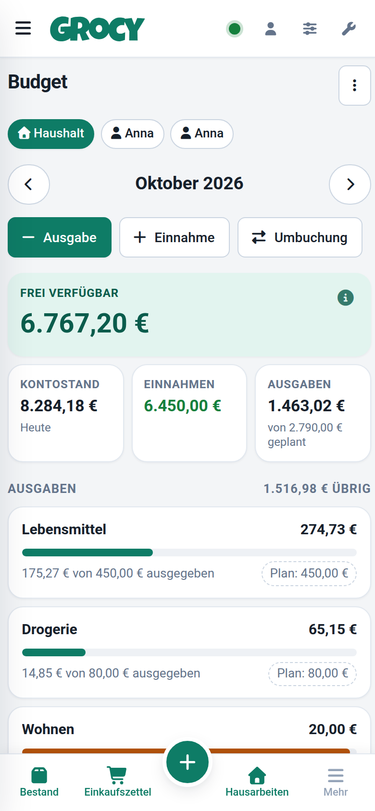 | 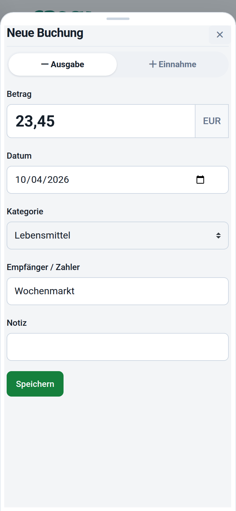 | 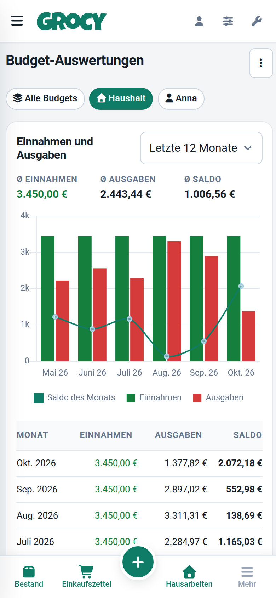 |
| Monatsübersicht mit Plan pro Kategorie | Buchung erfassen — auch über den `+`-Button | Einnahmen/Ausgaben und Ausgaben nach Kategorie |

- **Ein gemeinsamer Topf und persönliche Budgets.** Der „Haushalt“ ist für alle da; dazu kann jede Person ein eigenes Budget haben (z. B. Taschengeld). Alle mit Budget-Berechtigung sehen alle Budgets, ändern kann ein persönliches Budget aber **nur der Besitzer** — auch ein Administrator nicht. Budgets löschen und Besitzer ändern dürfen nur Administratoren.
- **Umbuchungen** verschieben Geld zwischen Budgets: im einen eine Ausgabe, im anderen eine Einnahme. Wer im Quell-Budget buchen darf, darf auch umbuchen — Taschengeld vom Haushalt an Anna geht also, aus Annas Budget heraus nur durch Anna.
- **Übertrag pro Kategorie.** Ohne Übertrag beginnt jeder Monat wieder bei seinem Plan; mit Übertrag wandert Übriges (oder Überzogenes) in den nächsten Monat — gedacht fürs Ansparen auf Urlaub oder Auto.
- **Pläne gelten ab einem Monat**, bis sie geändert werden; frühere Monate behalten ihren Plan.
- **Daueraufträge** (monatlich, vierteljährlich, halbjährlich, jährlich, auch als Umbuchung) werden bei Fälligkeit automatisch gebucht — beim nächsten Aufruf des Budgets, verpasste Termine werden nachgeholt. Der 31. heißt in kürzeren Monaten Monatsende.
- **Erstattungen** sind Einnahmen in einer Ausgaben-Kategorie und senken, was dort ausgegeben wurde.
- **Auswertungen:** Einnahmen, Ausgaben und Saldo pro Monat (6/12/24 Monate) sowie Ausgaben nach Kategorie für einen wählbaren Zeitraum — pro Budget oder über alle zusammen (dann ohne Umbuchungen, die verschieben ja nur Geld).
- Neue Budgets starten mit vorbefüllten Kategorien, die sich in den Budget-Einstellungen umbenennen, löschen und ergänzen lassen.

Zugriff steuert die neue Berechtigung **„Haushaltsbudget“** (Benutzer → Berechtigungen); Administratoren haben sie automatisch. Abschalten lässt sich das Ganze mit `Setting('FEATURE_FLAG_BUDGET', false);` in `data/config.php`. Bewusst nicht enthalten: Verknüpfung mit Grocys Einkäufen, CSV-Import, Bankanbindung, Split-Buchungen.

Beträge werden als ganze Cent gespeichert. Die REST-Endpunkte liegen unter `/api/budget/…` (Budgets, Kategorien, Pläne, Buchungen, Umbuchungen, Daueraufträge, Auswertungen; Beträge dort als Dezimalzahl) — sie stehen nicht in Grocys Swagger-Beschreibung, siehe [`routes.php`](routes.php) und [`BudgetApiController.php`](controllers/Api/BudgetApiController.php).

## Profile – mehrere getrennte Haushalte

Wer zwei Gebäude oder zwei Haushalte verwaltet, bekommt mit Profilen eine echte Trennung: **jedes Profil ist ein eigener, vollständiger Datenbestand** — Bestand, Hausarbeiten, Aufgaben, Kalender, Einkaufszettel, Rezepte, Speiseplan, Budget und Benutzer. Grocys Standorte können das nicht: Sie sind nur ein Merkmal von Bestandseinträgen, Hausarbeiten oder der Kalender kennen sie gar nicht.

|  |  |
|---|---|
| 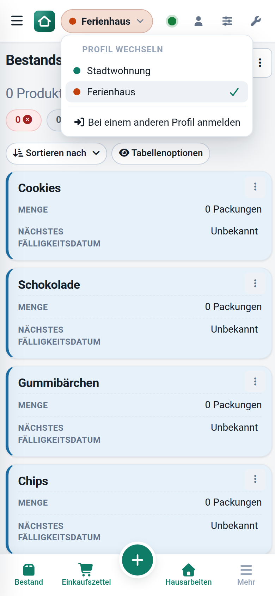 | 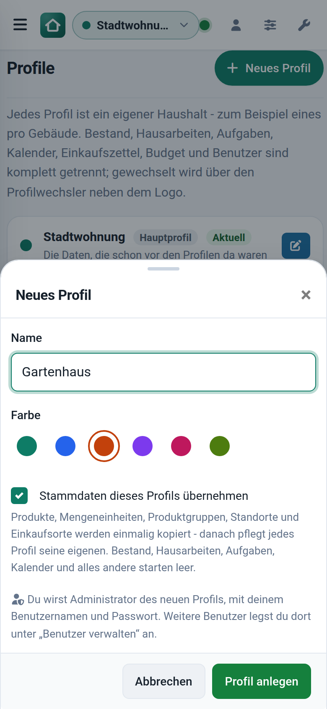 |
| Der Profilwechsler sitzt neben dem Logo | Neues Profil, auf Wunsch mit den Stammdaten des Hauptprofils |

- **Anlegen** unter Einstellungen (Schraubenschlüssel) → *Profile*, nur durch Administratoren des Hauptprofils. Die bisherigen Daten sind das Hauptprofil, es ändert sich für sie nichts. Solange es nur dieses gibt, ist von Profilen nichts zu sehen.
- **Stammdaten** (Produkte, Mengeneinheiten samt Umrechnungen, Produktgruppen, Standorte, Einkaufsorte, Barcodes, Produktbilder) können beim Anlegen einmalig übernommen werden; danach pflegt jedes Profil seine eigenen.
- **Benutzer gibt es pro Profil.** Wer ein Profil anlegt, wird dort Administrator, mit demselben Benutzernamen und Passwort, und ist sofort angemeldet. Weitere Benutzer kommen im jeweiligen Profil unter *Benutzer verwalten* dazu. Auf einem Gerät bleibt man in allen Profilen angemeldet, in denen man sich einmal angemeldet hat; der Wechsler zeigt nur diese — wer nur in einem Gebäude wohnt, hat das andere nicht im Weg. Auf der Anmeldeseite wählt man das Profil aus.
- **Wechseln** bleibt auf derselben Seite (Bestandsübersicht → Bestandsübersicht des anderen Haushalts). Jede Anfrage einer Seite trägt das Profil mit, für das sie angezeigt wurde — ein zweiter Tab, der inzwischen umgeschaltet hat, kann also nie Daten im falschen Haushalt ändern.
- **API-Keys** (Home Assistant & Co.) gehören zu genau einem Profil; Anfragen mit einem Key landen automatisch dort, ebenso der iCal-Link des Kalenders.
- **Löschen** verschiebt den Ordner eines Profils nur nach `data/profiles-deleted/` — wiederherstellbar von Hand.

Technisch ist ein Profil ein eigener Datenordner unter `data/profiles/<name>/` mit eigener Datenbank und eigenen Dateien; `config.php`, Plugins und eigenes CSS/JS gelten für alle. Die Liste der Profile steht in `data/profiles.json`. **Ein Backup von `data/` umfasst damit alle Profile.** Nach einem Update migriert jedes Profil seine Datenbank beim ersten Zugriff selbst, auch eines, das nur über einen API-Key benutzt wird.

## Barcode-Suche

Grocy fragt bei einem unbekannten Barcode nur Open Food Facts — also nur Lebensmittel — und übernimmt davon nur den Namen. Toilettenpapier, Spülmittel oder Shampoo musste man komplett selbst anlegen. Die Barcode-Suche (Taste **E** im Dialog für unbekannte Produkte) fragt stattdessen der Reihe nach:

1. **die anderen Profile** — kennt der andere Haushalt das Produkt schon, wird es samt Bild übernommen,
2. **die Open-Facts-Datenbanken** — Lebensmittel, Drogerie/Kosmetik (Open Beauty Facts), Haushalt und Sonstiges (Open Products Facts), Tierfutter; kostenlos, ohne Konto,
3. **auf Wunsch die KI-Websuche** — Claude sucht den Barcode in Onlineshops und Produktdatenbanken und öffnet vielversprechende Seiten, um die Nummer dort zu prüfen. Nur auf Knopfdruck, nur wenn eingerichtet. Findet die Suche über die Nummer nichts, hilft ein Stichwort von der Packung (z. B. Marke und Produktname): Damit sucht Claude nach dem Produkt selbst und prüft dessen Barcode.

|  |  |  |
|---|---|---|
| 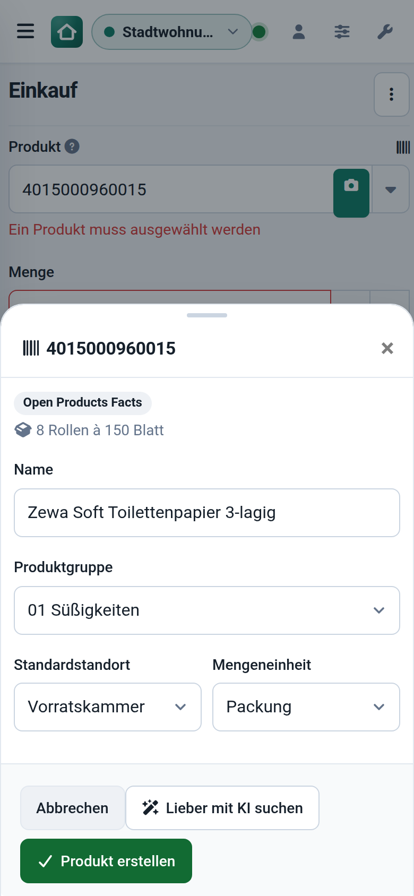 | 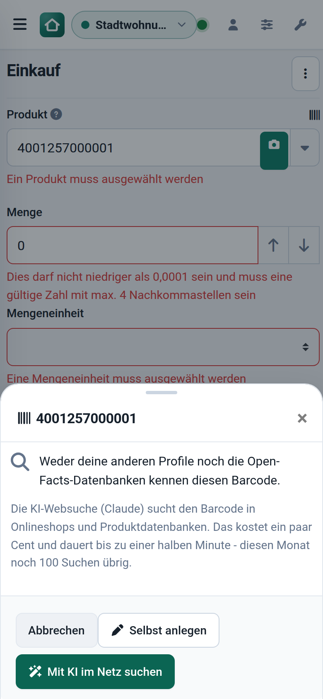 | 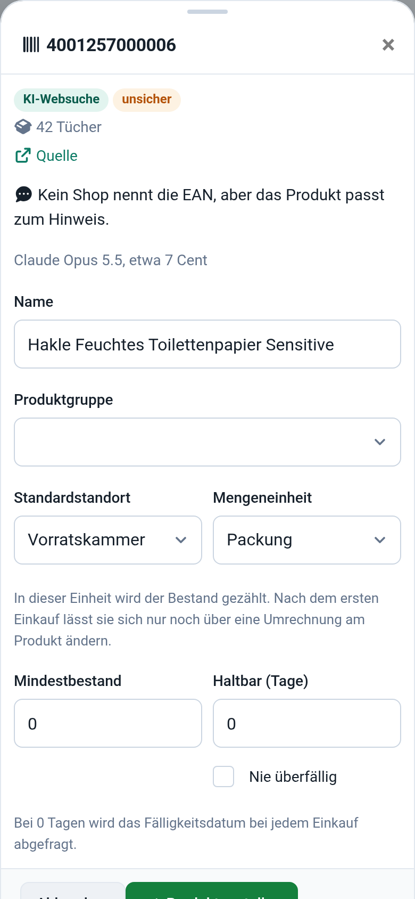 |
| Treffer als Vorschau zum Bestätigen | Unbekannt: KI-Websuche, optional mit Hinweis von der Packung | Ergebnis der KI mit Quelle, Sicherheit, Begründung und Kosten |

**Nichts wird ungefragt angelegt.** Jeder Treffer erscheint als Vorschau: Name (mit Marke), Packungsgröße, dazu Vorschläge für Produktgruppe, Standort, Mengeneinheit und Haltbarkeit aus dem, was es im Profil schon gibt, und ein Feld für den Mindestbestand. Diese Vorschläge werden mit der Zeit besser: Die Suche merkt sich, was man für eine Open-Facts-Kategorie (z. B. „Toilettenpapier“) gewählt hat, und übernimmt beim Wechsel der Produktgruppe deren üblichen Standort, die Einheit und die Haltbarkeit — Non-Food etwa ist dann gleich „nie überfällig“, und der Einkauf fragt kein Fälligkeitsdatum ab. Die Mengeneinheit sollte gleich stimmen: Nach dem ersten Einkauf bietet Grocy für den Bestand nur noch Einheiten an, für die es eine Umrechnung gibt. Dafür steht im Produkt unter der Bestandseinheit **„Bestand in anderer Einheit zählen“**: neue Einheit wählen, z. B. „1 Packung = 8 Rollen“ eintragen — die Umrechnung wird angelegt, das Produkt gespeichert, und Grocy rechnet Bestand, Einkaufszettel und Rezepte selbst um. Das gilt für alle Produkte, nicht nur für die aus der Barcode-Suche. Gibt es schon ein Produkt mit dem Namen, bietet die Vorschau an, den Barcode dort hinzuzufügen. Nach dem Bestätigen geht es zurück zum Einkauf, mit dem neuen Produkt ausgewählt.

**KI-Websuche einrichten:** Schraubenschlüssel → *Barcode-Suche* (nur Administratoren des Hauptprofils). Dort den API-Key von [console.anthropic.com](https://console.anthropic.com) eintragen — alternativ als Umgebungsvariable `ANTHROPIC_API_KEY` im Container —, das Modell wählen, die Zahl der Websuchen pro Anfrage (1–5, Standard 3) und ein Monatslimit (Standard 100).

| Modell | Preis je Million Tokens (Eingabe / Ausgabe) | |
|---|---|---|
| Claude Opus 5.5 | 4 $ / 20 $ | gründlichste Suche |
| Claude Sonnet 5.5 | 2 $ / 10 $ | halber Preis |
| Claude Haiku 5.5 | 0,10 $ / 0,50 $ | Bruchteil; Websuche ohne dynamische Filterung |

Dazu kommt jede Websuche mit 1 Cent (10 $ je 1.000), egal welches Modell — bei Haiku machen die Suchen fast die ganzen Kosten aus. Die meisten Tokens entstehen durch die Inhalte der gefundenen Seiten, die das Modell liest; mit Opus kamen so in der Praxis gut 15 Cent pro Suche zusammen. Was eine Suche gekostet hat, zeigt der Dialog direkt danach; die Einstellungsseite rechnet den Monat aus den tatsächlichen Tokens und Suchen jeder Anfrage zusammen und zeigt den Schnitt pro Suche. Maßgeblich bleibt die Abrechnung in der Anthropic-Konsole.

Findet die KI nichts, sagt sie kurz, was sie gesucht hat; bricht die Suche ab (keine Antwort, abgelehnt, zu lang), steht der Grund im Dialog. An Anthropic gehen nur der Barcode, ein eventueller Hinweis und die Namen eurer Produktgruppen, Standorte und Einheiten. Bei Opus und Sonnet ist `fallbacks: "default"` gesetzt: Lehnt eine Sicherheitsprüfung des Modells eine Anfrage ab, wiederholt die API sie auf dem dafür vorgesehenen Ersatzmodell. Bei Überlastung hilft das nicht — dann zeigt der Dialog den Fehler, und die Suche lässt sich einfach noch einmal starten. Haiku hat keinen solchen Ersatz.

Die Open-Facts-Datenbanken erlauben 15 Abfragen pro Minute; für einen Haushalt reicht das weit. Welche gefragt werden, lässt sich mit `Setting('BARCODE_LOOKUP_OPENFACTS_URLS', '…')` ändern.

## Installation

Zwei dokumentierte Wege:

| | |
|---|---|
| **[Docker / Docker Compose](docs/install-docker.md)** | Empfohlen. Bringt PHP 8.5 und SQLite mit, kein Build-Werkzeug auf dem Host. Inklusive Portainer-Stack und GitHub-Actions-Workflow, der das Image nach ghcr.io schiebt. |
| **[Proxmox LXC mit Apache2](docs/install-proxmox-lxc.md)** | Klassische Installation direkt auf dem Host. Braucht PHP 8.5 aus dem Sury-Repo sowie Composer und Yarn. |

Standard-Login nach der Installation: `admin` / `admin` — bitte sofort ändern.

> **Wichtig:** `update.sh` aus dem originalen Grocy **nicht** benutzen. Das Skript lädt das offizielle Release und überschreibt damit diesen Fork. Wie Updates stattdessen laufen, steht in beiden Anleitungen.

## Änderungen aus dem originalen Grocy übernehmen

Der Fork ist aktuell auf dem Stand von **Grocy 4.7.1**. Die GitHub-Funktion „Sync fork“ hilft hier nicht — sie kann nur fast-forwarden, und dieser Branch läuft dem Original voraus. Es bleibt ein Merge von Hand:

```bash
git remote add upstream https://github.com/grocy/grocy.git   # einmalig
git fetch upstream
git merge upstream/master
```

Das Redesign liegt weitgehend in eigenen Dateien (`grocy_theme.css`, `grocy_mobile.css`, `grocy_sheet.js`, `grocy_swipe.js`, `views/layout/bottomnav.blade.php`), die Konfliktfläche bleibt dadurch klein. Beim Merge auf 4.7.1 waren es sechs Dateien:

| Datei | Auflösung |
|---|---|
| `changelog/…` | Die eigenen Notizen liegen inzwischen in `changelog/900_grocy-modern_*.md`, eine Nummer, die das Original so schnell nicht erreicht — damit konfliktet die Datei künftig nicht mehr |
| `localization/*.po`, `*.pot` | Beide Seiten hängen nur an, also beide behalten |
| `public/css/grocy.css` | Die Fassung des Originals nehmen; die eigene Regel steht in `grocy_theme.css` und wird später geladen |
| `public/css/grocy_menu_layout.css`, `views/layout/default.blade.php` | Eigene Fassung behalten und nachziehen, was das Original darin wirklich geändert hat |

**Nach dem Merge prüfen**, ob das Original Abhängigkeiten angehoben hat — 4.7.1 brachte zwei Dinge mit, die sonst still auf die Füße fallen:

- **Font Awesome 6 → 7.** Die Icon-Schrift heißt jetzt `'Font Awesome 7 Free'`, und `fa-fw` gibt es nicht mehr (Icons sind von Haus aus feste Breite; das Gegenteil ist `fa-width-auto`). Beides muss auch in den Fork-eigenen Dateien nachgezogen werden.
- **Node 24.** `@zxing/library` verlangt es, der Assets-Build im `Dockerfile` lief noch auf Node 22 und wäre gescheitert.

> **⚠️ Beim Update auf 4.7.x:** Die Authentifizierungs-Middleware wurde umbenannt. Steht in `data/config.php` ein ausdrückliches `AUTH_CLASS`, muss aus `Grocy\Middleware\DefaultAuthMiddleware` jetzt `Grocy\Middleware\Auth\DefaultAuthMiddleware` werden — sonst antwortet Grocy mit HTTP 500. Alle Anmeldungen im Browser werden durch das Update ungültig, ein erneuter Login ist normal.

> Dieser Fork setzt auf dem `master`-Branch von Grocy auf, also der Entwicklungsversion. Datenbank-Migrationen garantiert Grocy offiziell nur zwischen Releases — vor einem Merge also ein Backup von `data/` ziehen.

## Geänderte Dateien

| Datei | Rolle |
|---|---|
| `public/css/grocy_theme.css` | Design-Tokens und alle Komponenten-Overrides |
| `public/css/grocy_mobile.css` | Karten-Darstellung der Tabellen, Touch-Ergonomie |
| `public/css/grocy_menu_layout.css` | Topbar, Sidebar, Drawer, Bottom-Navigation |
| `public/css/grocy_night_mode.css` | Dark Mode (nur Token-Overrides) |
| `public/js/grocy_menu_layout.js` | Drawer, Sidebar-Rail |
| `public/js/grocy_datatables.js` | Karten-Modus, Sortier- und Optionsleiste |
| `public/js/grocy_sheet.js` | Bottom-Sheets: Wisch-zum-Schließen, Zeilenmenüs |
| `public/js/grocy_swipe.js` | Wisch-Gesten auf den Karten |
| `public/js/grocy_toast.js` | Kompakte, aufklappbare Toasts |
| `public/js/grocy_dateinput.js` | Kurzformen für die Datumsfelder |
| `public/js/grocy_connection.js` | Verbindungsampel, Zeitlimit und Fehlermeldungen für API-Anfragen |
| `public/img/icon*.png`, `icon.svg` | App-Icon, Favicon, PWA und Homescreen |
| `views/layout/default.blade.php` | Neue App-Hülle |
| `views/layout/bottomnav.blade.php` | Bottom-Navigation |
| `helpers/extensions.php`, `controllers/BaseController.php` | Build-ID für das Cache-Busting (die einzige Änderung außerhalb des Frontends) |
| `Dockerfile`, `docker/`, `docker-compose.yml` | Container-Image |
| `migrations/5000.sql` | Haushaltsbudget: Tabellen und Berechtigung (Fork-Migrationen beginnen bei 5000, weit weg von Grocys eigener Nummerierung) |
| `services/BudgetService.php`, `controllers/BudgetController.php`, `controllers/Api/BudgetApiController.php` | Haushaltsbudget: Rechenlogik und Rechte, Seiten, API |
| `views/budget*.blade.php`, `views/components/budget*.blade.php`, `public/viewjs/budget*.js`, `public/js/grocy_budget.js`, `public/css/grocy_budget.css` | Haushaltsbudget: Oberfläche |
| `app.php` | Der Routen-Cache wird jetzt auch neu gebaut, wenn sich Routen oder Migrationen ändern — nicht nur bei einer neuen Versionsnummer. Profil der Anfrage wählen, Datenbank-Migration pro Profil |
| `helpers/Profiles.php`, `services/ProfileService.php`, `controllers/ProfilesController.php`, `controllers/Api/ProfilesApiController.php` | Profile: Auswahl pro Anfrage, Anlegen/Umbenennen/Löschen |
| `services/DatabaseService.php`, `services/FilesService.php`, `services/SessionService.php`, `services/BaseService.php` | Profile: Datenbank, Dateien und Login-Cookies des jeweiligen Profils |
| `views/profiles.blade.php`, `views/components/profileswitcher.blade.php`, `public/js/grocy_profiles.js`, `public/viewjs/profiles.js` | Profile: Verwaltung und Profilwechsler |
| `services/BarcodeLookupService.php`, `controllers/Api/BarcodeLookupApiController.php`, `controllers/BarcodeLookupController.php` | Barcode-Suche: Such-Kette, KI-Websuche, Anlegen aus der Vorschau |
| `public/js/grocy_barcodelookup.js`, `views/barcodelookupsettings.blade.php`, `public/viewjs/barcodelookupsettings.js`, `public/viewjs/components/productpicker.js` | Barcode-Suche: Dialog mit Vorschau, Einstellungen; die Taste „E“ der Produktauswahl öffnet den neuen Dialog |
| `public/js/grocy_forms.js` | Kürzere Formulare: Produkt, Einkauf, Verbrauch, Umlagern, Inventur, Hausarbeit und kleine Stammdaten-Formulare in Basis und aufklappbare Bereiche gegliedert, großer Scan-Knopf, Fehler erst nach Bearbeiten oder Speichern |
| `public/js/grocy_quchange.js`, `views/productform.blade.php` | „Bestand in anderer Einheit zählen“: Bestandseinheit eines schon gekauften Produkts wechseln, mit automatisch angelegter Umrechnung |
| `composer.json`, `composer.lock` | Das offizielle Anthropic-PHP-SDK für die KI-Websuche |

---

## Alles zu Grocy selbst

Funktionsumfang (bis auf das Haushaltsbudget), REST-API, Barcode-Scanner, Eingabe-Kürzel, Plugins und alles Weitere sind unverändert. Die maßgebliche Dokumentation dazu ist die des originalen Projekts:

- Website und Feature-Übersicht &rarr; <https://grocy.info>
- Original-Repository und README &rarr; <https://github.com/grocy/grocy>
- Öffentliche Demo &rarr; <https://demo.grocy.info>
- REST-API-Browser &rarr; die integrierte Swagger-UI unter `/api`
- Hilfe und Fragen zu Grocy &rarr; [r/grocy auf Reddit](https://www.reddit.com/r/grocy)

**Bugs und Feature-Wünsche, die das Design betreffen, gehören in dieses Repository. Alles andere gehört ins [Original](https://github.com/grocy/grocy/issues) — und bitte dort nicht mit diesem Fork verwechseln.**

Wenn dir Grocy gefällt: <https://grocy.info/#say-thanks>

## Lizenz

MIT — wie das originale Grocy. Copyright (c) 2017-2026 Bernd Bestel (<https://berrnd.de>), siehe [LICENSE](LICENSE).

Das Redesign in diesem Fork steht unter derselben Lizenz.
